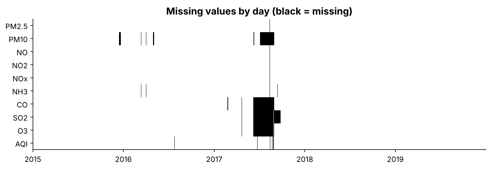
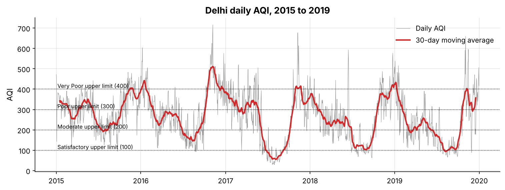
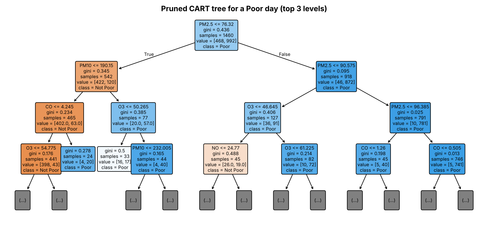
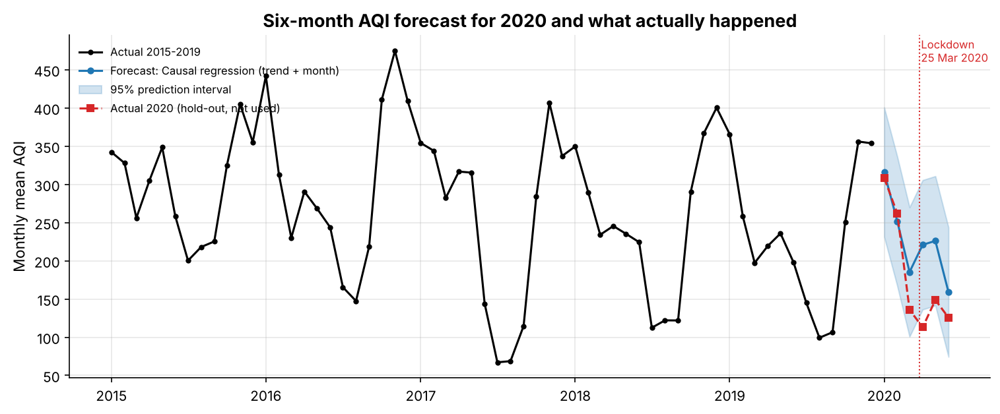
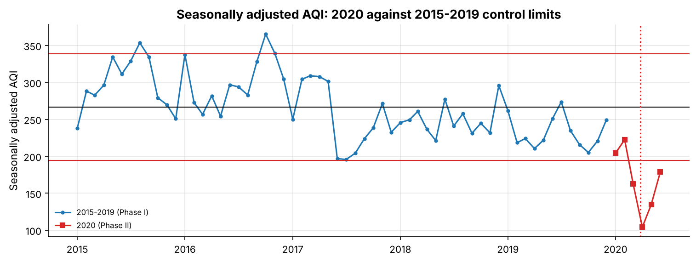

# Abstract

Air pollution decides whether a day in Delhi is safe to spend outdoors, and the Air Quality Index (AQI) is the single
number that reports it. Using 1,826 days of Central Pollution Control Board data (Kaggle, `city_day.csv`), this project
asks three questions: which pollutants drive AQI and how strongly; whether a day's AQI, and whether it will be "Poor or
worse" (AQI > 200), can be predicted from pollutant readings; and whether monthly AQI can be forecast six months ahead,
and when the process goes out of statistical control.

PM2.5 and PM10 are the dominant drivers (r = 0.88 each). A polynomial regression predicts daily AQI with test
R² = 0.885 (RMSE 40.5), and logistic regression classifies Poor days with 94.0% accuracy and ROC-AUC 0.981. For
forecasting, a regression on a time trend and calendar month beat ten alternatives, including SARIMA, Holt-Winters and
a VAR, over 19 rolling forecast origins (MAPE 11.8%, 27% better than a seasonal naive benchmark), and shows AQI falling
by about 19 points a year. Its forecast for 2020 was accurate in January-February (mean error +1.3) and then overshot
the lockdown months by 36%; control charts place March-June 2020 4 to 7 standard deviations below the 2015-2019 limits.
Every syllabus unit of 23XWA8 is applied to the same dataset, and the results are deployed as a Streamlit app.

# 1. Problem and objectives

Delhi is one of the most polluted large cities in the world. The Indian AQI converts eight pollutant concentrations
into sub-indices and reports the worst one, in six bands from Good (0-50) to Severe (401-500). The project's
objectives are:

1. **Drivers.** Which pollutants drive AQI, and how strongly?
2. **Prediction.** Can we predict a day's AQI, and whether it will be Poor or worse (AQI > 200)?
3. **Forecasting and control.** Can we forecast monthly AQI for the next six months, and when does the process go out
   of statistical control?

One dataset answers all three, so every unit is applied to the same story rather than to unrelated examples.

**An honest caveat.** AQI is *computed* from the pollutant readings. Regressing AQI on pollutants therefore partly
recovers that formula by construction, and these models are presented as measuring *which pollutant drives AQI and how
strongly*, not as discovering new atmospheric science. The forecasting part is the genuinely predictive work.

# 2. Data

| Item | Detail |
| --- | --- |
| Source | Kaggle, *Air Quality Data in India (2015 - 2020)*, file `city_day.csv` (CPCB data compiled by Vopani) |
| Raw size | 29,531 rows, 26 cities, 2015-01-01 to 2020-07-01 |
| Study window | Delhi, 2015-01-01 to 2019-12-31: 1,826 consecutive days, no duplicates, no missing dates |
| Hold-out | Delhi, January-June 2020 (lockdown from 25 March 2020), used only to test the forecast |
| Variables kept | PM2.5, PM10, NO, NO2, NOx, NH3, CO, SO2, O3 (µg/m³; CO in mg/m³), AQI, AQI_Bucket |
| Dropped | Benzene, Toluene, Xylene: not in the Indian AQI; Xylene 61% missing across cities |
| Derived | Year, Month, Season (IMD), Poor_Flag (AQI > 200), AQI_Group (Low ≤ 100, Moderate 101-200, High > 200) |

# 3. Data wrangling (notebook 01)

**Hidden missing values.** CO reads exactly 0 for 84 consecutive days in June-August 2017, and NOx is 0 on two days when
NO and NO2 are missing. A zero CO reading is physically impossible in Delhi; these are instrument outages and were
recoded as missing. Treating them as real would have biased every CO coefficient.

**Imputation chosen by experiment.** Rather than assume a method, known values were hidden and three methods were scored
on how well they recovered them (normalised RMSE, 20 repetitions, short 2-day holes and long 60-day blocks):

| Method | Short gaps | Long gaps |
| --- | --- | --- |
| Linear interpolation in time | **0.48** | 1.27 |
| Calendar-month median | 0.88 | 1.30 |
| Iterative (MICE) imputation from other pollutants + season | 0.63 | **1.08** |

Day-to-day persistence makes interpolation best for short gaps; for long gaps MICE wins for PM2.5, PM10 and NO2, and
interpolation for CO and O3. The method was therefore chosen per pollutant and gap length. Long outages remain uncertain
(errors near 1 for every method), so all 130 days with any imputed value are flagged in an `Imputed` column. AQI itself
(10 missing days, longest gap 4) was only interpolated in time, never predicted from pollutants.

**Outliers.** IQR screening flags 3-10% of pollutant values, but most are winter and post-monsoon smog days, which are
exactly the events under study. AQI was never altered; pollutants were winsorised at their 0.5th and 99.5th
percentiles (about 20 values each), which trims sensor extremes such as CO of 30 mg/m³ in December 2015 without
deleting high days. Isolated spikes (Hampel filter) are flagged, not removed. The cleaned file passes a 20-point data
contract (`src/check_contract.py`).

# 4. Exploratory analysis (notebook 02)

**Classification and tabulation.** Only 8.9% of days were Good or Satisfactory; 68.0% were Poor or worse and 12.9%
(236 days) Severe. Winter had **no** Good or Satisfactory day in five years.

| Band | Good | Satisfactory | Moderate | Poor | Very Poor | Severe |
| --- | --- | --- | --- | --- | --- | --- |
| Days | 23 | 139 | 423 | 507 | 498 | 236 |
| % | 1.3 | 7.6 | 23.2 | 27.8 | 27.3 | 12.9 |

**Central tendency, dispersion and shape.**

| Variable | Mean | Median | SD | Skewness | Excess kurtosis |
| --- | --- | --- | --- | --- | --- |
| PM2.5 | 120.4 | 97.7 | 81.9 | 1.39 | 2.12 |
| PM10 | 235.7 | 219.4 | 121.0 | 0.62 | -0.04 |
| AQI | 266.3 | 266.0 | 119.8 | 0.26 | -0.35 |

PM2.5 is strongly right-skewed with a heavy upper tail. AQI is nearly symmetric. The project pack expected a clearly
right-skewed AQI, but the AQI scale compresses high concentrations into narrow bands, which pulls in the tail.

**Seasonality.** Mean AQI is 351 in winter, 356 post-monsoon, 265 in summer and 160 in the monsoon. Kruskal-Wallis
H = 930 (p < 0.001) with effect size ε² = 0.51: season explains about half of the rank variation. November is the worst
month (mean 402), August the best (131).

**Correlation.** Pearson (Spearman) correlation with AQI: PM2.5 0.88 (0.92), PM10 0.88 (0.88), NO2 0.63, NO 0.62,
NOx 0.53, NH3 0.51, O3 0.38, SO2 0.38, CO 0.27 (0.54). CO's relation is monotonic but not linear.

**Point and interval estimates.** Mean AQI is 266.3. The textbook 95% t-interval (260.8-271.8) is too narrow because
daily AQI is strongly autocorrelated (lag-1 r = 0.90): the 1,826 days carry about as much information as 98 independent
days. The effective-n interval (242.3-290.4) and a 30-day moving-block bootstrap (240.2-289.4) agree. Likewise the share
of Poor days is 68.0%, with Wilson CI 65.8-70.1% but a dependence-aware bootstrap CI of 58.9-76.0%.

**Trend and 2020.** Annual mean AQI fell from 297 (2015) to 232 (2019). Spring 2020 (lockdown) averaged 133, about 50%
below the 2015-2019 spring average.

# 5. Regression (notebook 03)

**Simple linear regression.** AQI = 109.3 + 1.303 × PM2.5; R² = 0.783; t = 72.6 and F = 5,269 = t² (p < 0.001);
slope 95% CI 1.267-1.338. At PM2.5 = 100 the 95% confidence interval for mean AQI is 236.6-242.5, while the 95%
prediction interval for a single day is 130-349. Residuals are near-normal and homoscedastic (Breusch-Pagan p = 0.47),
but the Durbin-Watson statistic in date order is 0.69: strong positive autocorrelation.

**Multiple linear regression** (nine pollutants plus season, Winter as baseline): R² = 0.881, F = 891.7.

* Standardised coefficients: PM2.5 β = 0.43, PM10 0.38, CO 0.13, all others below 0.08.
* At equal pollutant levels a monsoon day is 32.6 AQI points lower than a winter day.
* VIFs are all below 6 (multicollinearity moderate). Breusch-Pagan p ≈ 1e-15 (heteroscedastic), but HC3 robust
  standard errors change no significance verdict. Durbin-Watson = 1.10.
* The largest Cook's distance is 0.05, far below 1. The most influential day (25 Feb 2017) records PM2.5 > PM10,
  which is physically impossible and a likely sensor error.
* A log(AQI) model worsened both heteroscedasticity and test RMSE (70.2 vs 41.1) and was rejected.
* Backward elimination by AIC removed SO2, NO2 and NO (AIC 15,036 → 15,032).

**Polynomial regression.** A centred PM2.5² term is negative and highly significant (partial F = 114.5). The marginal
effect of PM2.5 falls from 1.22 AQI per µg/m³ at 50 µg/m³ to 0.47 at 300, mirroring the compressed upper AQI bands.

| Model | Adj R² | Test RMSE | 10-fold CV RMSE | 2019 RMSE (trained 2015-18) |
| --- | --- | --- | --- | --- |
| Simple linear (PM2.5) | 0.774 | 56.7 | 55.9 | 47.1 |
| Multiple linear (AIC-selected) | 0.878 | 41.3 | 41.6 | 38.5 |
| **Polynomial (PM2.5²)** | **0.882** | **40.5** | **40.2** | **36.1** |
| CART regression tree | 0.884 | 40.3 | - | - |

The polynomial model wins on every measure among the regression equations, including a forward-in-time test on 2019
(R² 0.905). Refitting without imputed days changes the PM2.5, CO and squared-term coefficients by less than 10%.

# 6. Logistic and multinomial regression (notebook 04)

**Logistic regression for a Poor day** (stratified 80/20 split; 68% Poor):

* Likelihood-ratio test p < 0.001; McFadden pseudo R² = 0.741.
* Wald tests significant: PM2.5, PM10, NOx, CO, O3, NO2. Odds ratios: +10 µg/m³ of PM2.5 multiplies the odds of a
  Poor day by 1.69; +1 mg/m³ of CO by 1.81.
* Example: a median monsoon day has P(Poor) = 0.025, rising to 0.042 with 10 µg/m³ more PM2.5.
* Classification table (threshold 0.5): 11 missed Poor days and 11 false alarms out of 366; accuracy 0.940 (vs 0.680
  for always predicting Poor), precision and recall 0.956, ROC-AUC 0.981, **Gini 0.961**.
* Hosmer-Lemeshow: p = 0.73 (training) and 0.60 (test): no evidence of poor fit; the calibration curve hugs the diagonal.
* Treating a missed Poor day as 3 times as costly as a false alarm moves the threshold to 0.35 and cuts missed Poor
  days from 11 to 7.

**Multinomial regression** (Low / Moderate / High, Low as baseline, standardised pollutants; season excluded because
winter has no Low days, which would cause quasi-separation): accuracy 0.902, macro F1 0.854, one-vs-rest AUC 0.973.
Errors are ordinal: only one High day was predicted Low.

# 7. Decision trees (notebook 04)

* **CART classification tree** for Poor days, tuned by 5-fold cross-validation and cost-complexity pruned (23 → 20
  leaves). Root split **PM2.5 ≤ 76.3 µg/m³**, close to the official breakpoint (90 µg/m³) at which the PM2.5
  sub-index itself crosses 200. Gini importance: PM2.5 0.76, PM10 0.10, O3 0.07, CO 0.05. Test AUC 0.960.
* **CART regression tree** for AQI: test R² 0.886, RMSE 40.3, lowest MAE (28.6); PM2.5 carries 85% of importance.
* **CHAID idea:** season vs AQI group, χ² = 779.6, df = 6, p ≈ 4e-165, Cramér's V = 0.46. Monsoon has 14.3 standardised
  residuals more Low days than independence predicts, so CHAID would split on season first.
* **Unstructured data:** news text (mentions of stubble burning or firecrackers), satellite fire counts and festival
  calendars can be engineered into features. A "Punjab fire count yesterday" variable is the most promising extension.

# 8. Model comparison

| Task | Model | Accuracy | F1 | ROC-AUC | 5-fold CV AUC | 2019 AUC |
| --- | --- | --- | --- | --- | --- | --- |
| Poor day | **Logistic regression** | **0.940** | **0.956** | 0.981 | 0.980 | **0.976** |
| Poor day | CART tree (pruned) | 0.902 | 0.929 | 0.960 | 0.957 | 0.954 |
| Poor day | Random forest (benchmark) | 0.932 | 0.950 | 0.982 | 0.980 | 0.971 |
| AQI group | **Multinomial logistic** | **0.902** | **0.854** | **0.973** | - | - |
| AQI group | CART tree | 0.872 | 0.805 | 0.942 | - | - |

Logistic regression is the best Poor-day classifier. It is accurate, calibrated and interpretable, and a random forest
(beyond the syllabus) does not beat it. Multinomial regression beats the three-class tree on every measure.

# 9. Forecasting and time series analysis (notebook 05)

**Series.** Monthly mean AQI, 60 months; train January 2015-June 2019, test July-December 2019. STL gives a
seasonal strength of 0.85 and a trend strength of 0.32. Seasonal indices run from +143 (November) to -139 (July).

**Stationarity and identification.** ADF does not reject a unit root in the level (p = 0.86); after first or seasonal
differencing ADF rejects (p < 0.001) and KPSS does not. After seasonal differencing the PACF cuts off after lag 1 and
the ACF has a spike of -0.46 at lag 12, so the AIC grid selects SARIMA(1,0,0)(0,1,1)₁₂. Its seasonal MA coefficient
(-0.998) sits on the invertibility boundary, which is evidence that the seasonality is deterministic.

**Models compared** (test = 6 months; rolling = 19 origins × horizons 1-6):

| Model | Test RMSE | Test MAPE % | Rolling RMSE | Rolling MAPE % | Skill vs seasonal naive |
| --- | --- | --- | --- | --- | --- |
| **Causal regression (trend + month)** | 29.0 | 13.9 | **31.0** | **11.8** | **+27.5%** |
| Causal regression, AR(1) errors (GLS) | 26.3 | 12.1 | 34.6 | 12.8 | +19.1% |
| Holt-Winters (additive, damped) | 30.3 | 15.0 | 35.0 | 13.9 | +18.3% |
| SARIMA(1,0,0)(0,1,1)₁₂ | 45.9 | 24.4 | 42.6 | 18.7 | +0.5% |
| VAR(3) on AQI, PM2.5, PM10, NO2 | 33.9 | 15.7 | 42.6 | 17.3 | +0.4% |
| Seasonal naive | 30.7 | 15.3 | 42.8 | 18.0 | 0 |
| Seasonal moving average (3 yr) | 47.6 | 22.1 | 45.7 | 20.2 | -6.8% |
| ARIMA(2,1,2) | 89.3 | 55.6 | 92.9 | 45.6 | -117% |
| Naive / SES / MA(3) | 108-110 | 55-61 | 129-133 | 55-62 | about -200% |

* Methods that ignore seasonality fail badly; simple exponential smoothing chose α = 0.995 and became the naive forecast.
* The causal regression (trend -1.56 AQI per month, about 19 per year) is the most accurate and its error is flat
  across horizons. Lagged pollutants (6 months) did not improve it, a useful negative result. Its residuals are
  autocorrelated (DW 1.08); a GLS fit with AR(1) errors (ρ = 0.43) gives honest standard errors but no better
  rolling accuracy.
* **VAR(3):** NO2 and PM10 Granger-cause AQI (p = 0.001); by six months ahead PM10 shocks explain 34% of AQI forecast
  variance. One month ahead the VAR is as accurate as the causal model (RMSE 31.6).

**Six-month forecast and the COVID-19 check.** Refitted on all 60 months, the model forecast January-June 2020. January
and February were almost exact (mean error +1.3). From April to June actual AQI was **36% below** the no-lockdown
forecast, a rough estimate of the lockdown effect.

**Daily ARMA model.** A regression with ARMA(2,2) errors (trend plus three annual Fourier pairs) forecasts next-day AQI
in 2019 with RMSE 50.2, beating persistence (54.0) and climatology (80.5); its 95% intervals cover 92.9% of days.

# 10. Statistical quality control (notebook 06)

| Chart | Result | Conclusion |
| --- | --- | --- |
| I-MR on raw monthly AQI | 14/60 signals, mostly seasonal | not valid for a seasonal series |
| I-MR on seasonally adjusted AQI | beyond 3σ: Aug 2015, Oct 2016, Nov 2016; runs above the centre before mid-2017 and below after | special causes: the 2016 smog episode; a sustained improvement |
| X̄-S (month = subgroup) | 45/60 outside | rational subgrouping fails: between-month ≫ within-month variation |
| p-chart, share of Poor days | 36/60 outside; χ² = 1,015 on 59 df | over-dispersion; Laney p′ (σz = 1.97) leaves the monsoon months as signals |
| Phase II, 2020 | Mar-Jun 2020 between 4.3σ and 6.8σ below the LCL | special cause: the COVID-19 lockdown |

# 11. Deployment

A Streamlit app (`app/app.py`) has six tabs: Overview, EDA (filterable), Predict (sliders for pollutants and season,
returning the regression, logistic, tree and multinomial outputs), Forecast (with a 2020 toggle), Control charts and
Model performance. The app only reads saved outputs; the models are exported as plain JSON and rebuilt with numpy,
so the deployed app needs neither statsmodels nor scikit-learn. Notebooks verify that the exported models reproduce the
fitted ones to machine precision, and 30 automated tests check the rules, data contract, outputs and app predictions.

# 12. Conclusions by syllabus unit

| Unit | Conclusion |
| --- | --- |
| Data wrangling | Hidden zeros (CO outage) were the most important cleaning step; the imputation method was chosen by experiment, and outliers were kept because the extremes are the story. |
| Linear regression | PM2.5 alone explains 78% of AQI variation; each µg/m³ adds 1.3 AQI points on average. Mean-response and single-day intervals differ by a factor of 37. |
| Multiple regression | PM2.5 and PM10 dominate (β 0.43, 0.38); heteroscedasticity and autocorrelation are present but do not change conclusions; AIC keeps six pollutants plus season; a squared PM2.5 term captures the compressed AQI scale. |
| Logistic & multinomial | Poor days are predicted with 94% accuracy, AUC 0.98 and good calibration; a cost-based threshold makes the model a better warning tool. |
| Decision trees | Trees rediscover the AQI breakpoints (PM2.5 ≈ 76-90 µg/m³) and are easy to explain, but are less accurate than logistic regression; CHAID would split on season first. |
| Forecasting | Calendar-plus-trend regression forecasts six months ahead with 12% MAPE and 27% skill over the seasonal naive benchmark. |
| Time series | Seasonality is deterministic and dominant; SARIMA and VAR add little at 6 months, but VAR is competitive one month ahead and ARMA errors beat persistence for next-day forecasts. |
| Control charts | Charts must be applied to seasonally adjusted data with over-dispersion corrected; they then flag the 2016 smog, the post-2017 improvement and the 2020 lockdown. |

# 13. Limitations and future work

* AQI is a deterministic function of the pollutants, so the same-day models are partly circular.
* One city and five years; long sensor outages are imputed with substantial uncertainty (flagged and tested).
* Weather (wind speed, temperature inversion, rainfall) and satellite fire counts are absent; adding them is the most
  promising route to sharper October-November forecasts.
* The 2020 "lockdown effect" is a counterfactual estimate that ignores 2020's own weather.

# References

1. Vopani (Rohan Rao). *Air Quality Data in India (2015 - 2020)*, Kaggle dataset, file `city_day.csv`.
2. Central Pollution Control Board (2014). *National Air Quality Index*, Ministry of Environment, Forest and Climate
   Change, Government of India.
3. Hyndman, R. J. and Athanasopoulos, G. *Forecasting: Principles and Practice*, 3rd ed., OTexts.
4. Montgomery, D. C. *Introduction to Statistical Quality Control*, Wiley.
5. Hosmer, D. W., Lemeshow, S. and Sturdivant, R. X. *Applied Logistic Regression*, 3rd ed., Wiley.
6. Laney, D. B. (2002). Improved control charts for attributes. *Quality Engineering* 14(4), 531-537.
7. Seabold, S. and Perktold, J. (2010). statsmodels: Econometric and statistical modeling with Python. *Proc. SciPy*.

# Appendix: reproducibility

All randomness uses seed 42. `python scripts/run_all.py` re-executes the six notebooks from the raw Kaggle file, then
runs the data-contract check and the tests. All result tables are in `outputs/tables/` and all figures in
`outputs/figures/`.
